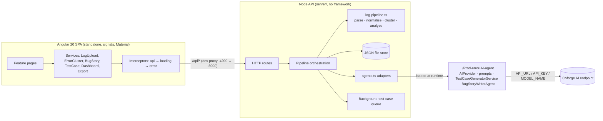
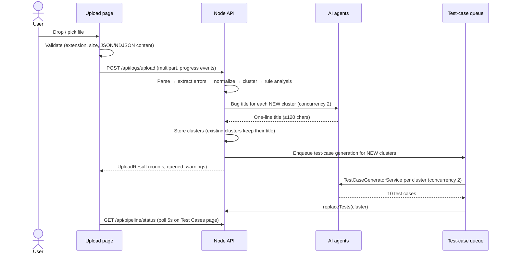

# Production Log Mining Portal: Flow, Rules and Technical Design

This document describes what the portal does, the rules it applies at each step, and how the pieces are built.
It is meant for demos and for engineers who need to extend or operate the app.

- [1. What it does](#1-what-it-does)
- [2. Architecture](#2-architecture)
- [3. End-to-end flow](#3-end-to-end-flow)
- [4. Processing rules (parse → cluster → analyze)](#4-processing-rules)
- [5. AI agents and their rules](#5-ai-agents-and-their-rules)
- [6. REST API](#6-rest-api)
- [7. Feature walkthrough (by page)](#7-feature-walkthrough-by-page)
- [8. Exports](#8-exports)
- [9. Frontend technical design](#9-frontend-technical-design)
- [10. Error handling and resilience](#10-error-handling-and-resilience)
- [11. Security and data handling](#11-security-and-data-handling)
- [12. Configuration and run modes](#12-configuration-and-run-modes)
- [13. Demo script](#13-demo-script)
- [14. Known limitations](#14-known-limitations)

---

## 1. What it does

Upload production logs (`.json` / `.ndjson`). The portal finds the error records, groups similar errors into
**clusters**, and uses AI agents to produce:

| Output | Produced by |
|---|---|
| Business-friendly **bug title** per cluster | AI agent (bug-title prompt) |
| **Regression test cases** per cluster (10 each) | AI agent (test-case generator) |
| **Bug story** (description + 5 acceptance criteria) | AI agent (bug-story writer) |
| Category (agent repo's _TC report, rule file as fallback), severity, confidence, RCA, business impact | Deterministic rules |
| Dashboard metrics and charts | Computed from stored clusters |

The AI agents are not part of this repo. They are loaded **at runtime from the sibling repo
`Prod-error-AI-agent`**, so the portal and that repo use exactly the same prompts and agent code.

---

## 2. Architecture



| Layer | Location | Notes |
|---|---|---|
| UI | `src/app/features/*` | One lazy-loaded route file per feature |
| Core | `src/app/core/*` | Interceptors, notifications, loading state, layout shell, mock backend |
| Shared | `src/app/shared/*` | Charts (SVG, no chart library), page header, severity chip, error boundary, empty state, confirm dialog |
| Models | `src/app/models/*` | `LogEntry`, `ErrorCluster`, `BugStory`, `AcceptanceCriteria`, `TestCase`, `DashboardMetrics`, `APIResponse` |
| Services | `src/app/services/*` | Observable-based API clients and the export service |
| Server | `server/*` | `index.ts` (routes), `pipeline.ts`, `agents.ts`, `store.ts`, `config.ts` |
| Shared logic | `src/app/core/mock/log-pipeline.ts` | Pure functions used by **both** the server and the in-browser mock |

The AI key never reaches the browser. Only the Node API talks to the AI endpoint.

---

## 3. End-to-end flow

### 3.1 Upload



The upload response returns as soon as titles are done. Test cases are produced in the background because each
cluster needs one long AI call (about 15 to 30 seconds).

### 3.2 Regenerate test cases

`POST /api/clusters/:id/test-cases` runs the same agent synchronously for one cluster and **replaces** that
cluster's test cases (the set can change size, so old ones are deleted first). IDs stay stable:
`TC-<clusterId without dash>-NN`.

### 3.3 Generate a bug story

`POST /api/clusters/:id/bug-story` with `{ "force": false }`:

- If a story already exists and `force` is not `true`, the existing story is returned (edits are protected).
- Otherwise the bug-story agent runs and the story is stored.
- The UI asks for confirmation before regenerating over an existing story (`force: true`).

---

## 4. Processing rules

All rules in this section are deterministic and live in `src/app/core/mock/log-pipeline.ts`.

### 4.1 File acceptance (client)

| Rule | Value |
|---|---|
| Extensions | `.json`, `.ndjson` |
| Max size | 50 MB (`environment.upload.maxFileSizeMb`; server enforces `MAX_UPLOAD_MB`) |
| Empty file | Rejected |
| `.json` | Must be a JSON array, or an object containing an array under `logs`, `records`, `entries`, `events`, `items` or `data`, or a single object |
| `.ndjson` | Every non-empty line must be a JSON object. The error names the first bad line (for example "line 2 is invalid") |

### 4.2 Field mapping (tolerant parser)

| `LogEntry` field | Accepted source keys |
|---|---|
| `timestamp` | `timestamp`, `@timestamp`, `time`, `ts`, `datetime` (invalid or missing → now) |
| `level` | `level`, `severity`, `lvl`, `logLevel`. `WARNING`→`WARN`, `CRITICAL`/`EMERGENCY`/`ALERT`→`FATAL`, `ERR`/`SEVERE`→`ERROR`, unknown→`INFO` |
| `message` | `message`, `msg`, `text` (falls back to the `exception`/`error` text) |
| `module` | `module`, `service`, `logger`, `component`, `appName`, `app` (else `unknown`) |
| `exceptionType` | `exceptionType`, `exception_type`, `errorType`, `exceptionClass`, `exception.type`; otherwise inferred with `*Exception` / `*Error` from message, stack and error text |
| `stackTrace` | `stackTrace`, `stack_trace`, `stack`, `exception.stack` (capped at 2000 chars) |
| `correlationId` | `correlationId`, `x-correlation-id`, `traceId`, `requestId` |
| `appName`, `service`, `context` | Same-named keys (used by the AI agents) |
| `url` / `statusCode` | `http.url` or `url` / `http.statusCode` or `statusCode` |
| `error` | String `error` field (capped at 2000 chars) |

### 4.3 What counts as an error record

A record is an error when **any** of these is true:

1. `level` is `ERROR` or `FATAL`
2. It has a non-empty `error` string (same rule as the agent repo)
3. `message`, `exceptionType` or `stackTrace` contains "exception" (case-insensitive)

### 4.4 Normalization (builds the error signature)

Applied in this order to `"<exceptionType>: <message>"`:

| # | Pattern | Replaced with |
|---|---|---|
| 1 | UUID | `<UUID>` |
| 2 | ISO timestamp | `<TS>` |
| 3 | Email address | `<EMAIL>` |
| 4 | IPv4 (optional `:port`) | `<IP>` |
| 5 | `0x…` hex | `<HEX>` |
| 6 | Query string `?a=b…` | `?<QUERY>` |
| 7 | Quoted string up to 80 chars | `<STR>` |
| 8 | Any number (no word boundary, so `20000ms` and `user42` collapse too) | `<N>` |

Whitespace is collapsed and the result is truncated to 200 characters.

### 4.5 Clustering and how frequency is decided

**Frequency (the "Occurrences" column) is the number of error log records that fall into the same group.**
It is decided by the grouping parameters below, not by timestamps, correlation ids or the error text alone.

```
for each log record:
  1. keep it only if it is an error record (section 4.3)      ← INFO / WARN / success lines are dropped here
  2. choose its group:
       if record has BOTH context AND url   → group = (context, url)            basis "context+url"
       else                                 → group = (module, normalized msg)  basis "module+signature"
  3. occurrences[group] += 1
```

| Parameter | Role in the count |
|---|---|
| `level` / `error` field / "exception" text | Decides whether a record is counted at all (4.3) |
| `context` + `url` | **Primary grouping parameters.** Two error records with the same context **and** the same URL belong to one cluster, whatever their message says (same rule as the agent repo's `analyze-skypad-errors.ts`) |
| `module` + normalized message (signature) | **Fallback grouping** when a record lacks `context` or `url`. Ids, numbers, timestamps, emails and IPs are masked (4.4), so `Timeout after 20000ms` and `Timeout after 30000ms` are the same group |
| `timestamp` | Not used for grouping. Only sets `firstSeen`, `lastSeen` and the daily trend |
| `correlationId`, `message`, `statusCode` | Not used for grouping when `context + url` exist (a cluster can contain different messages or status codes) |

Worked example (from the Skypad log analyzed with `npm run cluster:freq`): 959 error records were split into 18
groups. The group `AmadeusSeatMapService.getSeatMapDetails | /scheduler-job/trigger` received 418 error records,
so its frequency is 418 (43.6% of all errors). The 20,662 INFO/WARN records never entered the count.

What the count does **not** mean:
- It counts **error log lines**, not distinct requests or users (one request can log several errors).
- It is **cumulative across uploads, but overlapping uploads are not double counted**: a record already stored for
  the cluster (same timestamp, correlation id, message and error) is skipped, and a file with exactly the same
  content as an earlier upload is rejected ("already processed"). Identical duplicate lines inside a single file are
  all counted.
- Because grouping uses the raw URL, URLs that embed ids or query values (for example `?crew_id=16559`) create
  separate clusters per value.
- The Cluster Details page shows the grouping basis and key for every cluster ("How this frequency is counted").

Other clustering facts:
- **Cluster id**: `CL-` + 6-character base-36 hash of the group key (stable across uploads).
- Tracked per cluster: `occurrences`, `fatalCount`, `firstSeen`, `lastSeen`, `groupBasis`, `groupKey`, up to
  **5 sample logs**.
- **Occurrence records**: every error record behind a cluster's frequency is stored (cap
  `MAX_OCCURRENCES_PER_CLUSTER` = 5000 per cluster; the frequency itself is never capped) and listed on the Cluster
  Details page (section 7).
- **Re-upload**: a cluster with the same id is merged. Only records not already stored are added to the count,
  first/last seen are widened, and the cluster keeps its existing AI title, bug story and test cases.
- **Backfill for older data**: clusters stored before every record was kept only have their (up to 5) sample logs.
  `npm run backfill -- <the original log file>` attaches all records to the existing clusters **without changing any
  count, title, test case or dashboard total** (it calls `POST /api/logs/upload?mode=backfill` on the running API,
  and warns if the file's record count differs from a cluster's counted frequency).
- **Check it yourself**: `npm run cluster:freq -- <file>` prints the same frequency table for any log file without
  the server or AI.

### 4.6 Category (from the agent repo's _TC report)

**Primary source.** Each cluster's category is the `category_id` of its entry in the agent repo's
`test-results/SkypadLogs-Error-report_TC.json` (`errors[]`), matched on the cluster's `context` (the entry with the same
`url` wins if several share a context). The value is used verbatim. `REPORT_TC_FILE` overrides the path. When the
file changes, the next API request re-applies it to every stored cluster (no restart, no re-upload).

**Fallback for clusters with no entry in that report** (for example a new upload the agent pipeline has not seen
yet): the API categorizes with the **agent repo's own knowledge base**,
`packages/dynatrace/kb/logs-failure-categories.json` (`KB_FILE` overrides the path, re-read whenever the file
changes). It holds ~18 rules with Skypad-specific patterns (AIMS, Amadeus, Datahub, crew/seat-map), each belonging
to one of the 7 category groups below. `server/categorizer.ts` applies them exactly as
`packages/dynatrace/src/app-log-analyzer.ts` does:

1. **Per record**, test `message + stackTrace + error` (case-insensitive) against every rule **in file order**; the
   first rule with a matching regex wins, and the record votes for that rule's `group`.
2. **Per cluster**, the group with the most votes becomes the category. Ties go to the group that appears first in
   the rule file. A cluster whose records match no rule at all is `Uncategorized`.

Voting matters because one cluster (same `context` + `url`) can hold records with different causes (for example
3 "AIMS SOAP Fault" records and 6 "Invalid credentials" records would vote *Authentication & Authorization*).

| Group (file order) | Example rules | Severity bump |
|---|---|---|
| Database | schema/query failure, connection pool | +1 |
| Network & Connectivity | downstream timeout, ECONNREFUSED/ECONNRESET | none |
| Authentication & Authorization | JWT/401/403, TLS certificate, config & secrets | +1 |
| Resource Exhaustion | OutOfMemory, ENOSPC, HTTP 429 | +1 |
| Data Handling | data not found (No guests found, Required data missing), NullPointer/TypeError | none |
| Validation | invalid flight details, business-rule conflict (already exists), input validation | none |
| Integration | AIMS SOAP fault, Amadeus error, downstream 4xx, generic 5xx | none |
| Uncategorized | nothing matched | none |

**Fallback.** When the rule file cannot be read, the portal keeps working with the built-in keyword rules in
`src/app/core/mock/log-pipeline.ts` (same 7 groups, one regex each, matched against the signature plus up to 800
characters of sample error text) and logs a warning. Offline mock mode always uses those built-in rules.

**Existing data.** `pipeline.recategorize()` runs at API start-up and whenever the _TC report changes, and
re-applies both sources to every stored cluster (a change to the rule file alone takes effect on a restart). It only
rewrites the category-driven
fields (category, severity, confidence, root cause, business impact). Counts, bug titles, test cases and bug
stories are untouched.

### 4.7 Severity

```
if fatalCount > 0                → Critical
else base = occurrences ≥ 100 → Critical
            ≥ 25  → High
            ≥ 5   → Medium
            else  → Low
     if category is Database / Authentication / Resource Exhaustion → raise one level (max Critical)
```

### 4.8 Confidence score

```
base  = 0.68 (0.50 if Uncategorized)
      + 0.10 if an exception type was seen
      + 0.10 if a stack trace was seen
      + min(0.10, occurrences / 500)
score = min(0.98, base), rounded to 2 decimals
```

### 4.9 RCA and business impact

Each category carries a root-cause paragraph, a business-impact sentence (with the module name filled in) and a
"suggested checks" list. These are template-based and deterministic. The bug-story agent does **not** write them;
the bug story reuses them.

### 4.10 Dashboard metrics

| Metric | Definition |
|---|---|
| Total Logs Processed / Total Errors | Running totals across all uploads |
| Unique Error Clusters | Number of clusters |
| Critical / High / Medium / Low errors (KPI cards, second row) | **Number of clusters** at that severity; the pill shows that severity's share of all error records |
| Errors by Severity (chart) | **Sum of occurrences** per severity |
| Errors by Module (chart) | One bar per `context` of the agent repo's `SkypadLogs-Error-report_TC.json`, valued by that entry's `totalErrorOccurrences`, highest first (entries sharing a context are summed); the first 10 are shown and the rest sit behind a **View more** button (Show less collapses it again); each name stays on one line, cut after 36 characters with `...` (the full name is in the hover tooltip). Falls back to the top 8 modules by occurrences when the report is unavailable |
| Errors per day (computed by the API as `trend`, no longer shown on the dashboard) | Last 30 days |

---

## 5. AI agents and their rules

### 5.1 Where the agents come from

`server/agents.ts` loads these from `AGENT_REPO_PATH` (default `../Prod-error-AI-agent`) at runtime:

| Purpose | Loaded component |
|---|---|
| Provider | `packages/ai/providers/AIProvider.ts` (`API_URL`, `API_KEY` sent as `X-API-KEY`, `MODEL_NAME`) |
| Test cases | `TestCaseGeneratorService`, `StructuredResponseService`, `prompts/testcase-generator-prompt.md` |
| Bug story | `BugStoryWriterAgent` |
| Bug title | `prompts/Bug-Title-generator-prompt.md` (the script logic is reproduced because it is not exported) |

### 5.2 Bug title

| Rule | Detail |
|---|---|
| When | Once per **new** cluster during upload. Existing clusters keep their title |
| Input sent | `{ appName, context, url, message, error }` only |
| Prompt format | `[Component] <what fails> when/due to <cause>`, max 120 chars, no correlation ids/stack traces, dates like `291026` shown as `29-Oct-2026`, never guess a cause |
| Post-processing | First non-empty line only, truncated to 120 chars (`...`) |
| If AI is down or fails | Rule-based title is used and an upload warning is returned |

### 5.3 Test cases (generation and regeneration)

| Rule | Detail |
|---|---|
| Count | Exactly 10 per cluster: **5 positive, 3 negative, 2 edge** (order enforced by the prompt) |
| Input sent | `id, bugTitle, appName, service, context, url, statusCode, message, error`. Correlation ids are never sent |
| Prompt rules | Includes one regression test (priority High) that reproduces the failure; negative cases expect handled responses; expected results must be measurable (status, body field, log level); no invented endpoints |
| Validation | Response must be a JSON array of 10 objects, validated with zod (`Test Case ID`, `Scenario`, `Test Steps`, `Expected result`, `Priority` ∈ High/Medium/Low) |
| Retry | One extra attempt if the model returns invalid JSON or fails schema validation |
| IDs | `TC-<clusterId without dash>-NN` (for example `TC-CL11SUR6-01`) |
| Mapping to portal model | Steps split on newlines with numbering stripped; expected result becomes a one-item list; **preconditions are derived** from app/service/url because the prompt has no such field |
| Queue | In-memory, concurrency `AI_CONCURRENCY` (default 2); on server start, clusters with no test cases are re-queued |
| Regeneration | Synchronous per cluster; deletes the cluster's old cases and stores the new set |
| Failure | Background failures are counted and shown on the Test Cases page with the last error; regeneration returns 502/503 |

### 5.4 Bug story

| Rule | Detail |
|---|---|
| Input | Cluster mapped to the agent's `DynatraceFailure` shape (same mapping as the agent repo's report reader) |
| Output | Description (Business context, failure scenario, customer impact) and **exactly 5** acceptance criteria `AC1..AC5` |
| Title | The cluster's AI bug title |
| Root cause / business impact | From the rule-based cluster analysis (the agent does not produce them) |
| Bad output | If the agent returns its placeholder text ("Unable to generate AI description" / "Generation failed"), the request fails with 502 instead of storing junk |
| Existing story | Returned as-is unless `force: true` |
| Editing | Title, description, RCA, impact and criteria are editable; the server only accepts those fields |

### 5.5 AI call resilience

Implemented by wrapping the provider instance (the agent repo is not modified):

| Rule | Value |
|---|---|
| Retry on | HTTP 5xx, HTTP 429, network errors, timeouts |
| Not retried | 4xx (bad request, auth) |
| Attempts / backoff | `AI_RETRIES` = 3, delays about 2s, 4s, 8s plus jitter |
| Per-call timeout | `AI_TIMEOUT_SECONDS` = 150 |
| Error mapping | AI not configured → 503; AI call failed → 502 with a message capped at 300 chars |

---

## 6. REST API

All responses use the envelope `{ success, data, message?, errors?, timestamp }`.

| Method | Path | Request → Response |
|---|---|---|
| GET | `/api/health` | `{ status, aiConfigured }` |
| POST | `/api/logs/upload` | multipart field `file` → `UploadResult`. `?mode=backfill` only attaches occurrence records to existing clusters (no count changes). The same file content twice returns a warning and changes nothing |
| GET | `/api/pipeline/status` | `{ pendingClusters, failedClusters, lastError? }` |
| GET | `/api/dashboard/metrics` | `DashboardMetrics` |
| GET | `/api/clusters`, `/api/clusters/:id` | `ErrorCluster[]` / `ErrorCluster` |
| GET | `/api/clusters/:id/occurrences?page=&pageSize=&sort=&dir=&q=` | `OccurrencePage { items, total, page, pageSize, stored }`. Server-side search (`q` over message, error, correlation id, url, context), sort (`timestamp`, `level`, `statusCode`, `phase`, `message`, `correlationId`; default newest first), `pageSize` clamped to 1 to 200 |
| POST | `/api/clusters/:id/bug-story` | `{ force?: boolean }` → `BugStory` |
| POST | `/api/clusters/:id/test-cases` | → `TestCase[]` |
| GET | `/api/bug-stories?clusterId=` | `BugStory[]` |
| PUT | `/api/bug-stories/:id` | editable `BugStory` fields → `BugStory` |
| GET | `/api/test-cases?clusterId=` | `TestCase[]` |

`UploadResult`: `uploadId, fileName, totalRecords, errorRecords, clustersCreated, clustersUpdated,
testCasesGenerated, testCasesQueued, warnings?`.

Status codes used: 200, 400 (bad body/multipart), 404 (unknown cluster/story/route), 413 (too large),
422 (unparseable log file), 500, 502 (AI failed), 503 (AI not configured).

---

## 7. Feature walkthrough (by page)

| Page (route) | What it shows | Key behavior |
|---|---|---|
| **Dashboard** `/dashboard` | 7 KPI cards with trend pills (3 totals, then the 4 severity levels), donut (errors by severity), bar list (errors by module), and a vertical timeline of the six most recently active clusters (newest first, each links to its cluster) | Empty state until logs are uploaded; retry on load failure |
| **Upload Logs** `/upload` | Drag-and-drop zone, file picker, progress bar, result summary | Phases: validating → uploading (%) → processing → done. Keyboard accessible. Shows warnings and "AI is writing test cases" note |
| **Error Clusters** `/clusters` | Material table: Cluster Id, Error Signature, Category, Severity, Occurrences, Created at (shows the cluster's last-seen time). The **Error Signature** cell shows the `Cluster` value from the agent repo's `test-results/SkypadLogs-Error-report.json` (`errors[]`) when an entry there has the same `context` as the cluster (the entry with the same URL wins if several share a context); clusters with no matching entry keep their normalized signature. The file is re-read whenever it changes (`REPORT_FILE` overrides the path) | Compact filter panel: search (id, bug title, signature, module, category), **multi-select** severity and category, a **date-range picker** on Created at, removable **filter chips** with Clear all and an "N of M clusters" count; sort on every column (severity sorts by rank), pagination 10/25/50, row click opens details |
| **Cluster Details** `/clusters/:id` | Tabs: Overview, RCA, Related Bugs, Generated Tests. The header shows **module › context**: the application (`appName`) and the class.method that logged the error (falls back to the service, then `module`, when a log lacks these fields) | Buttons **Generate/Regenerate Bug Story** and **Generate/Regenerate Test Cases** with a busy banner. Overview shows severity, frequency (ⓘ icon opens "How this frequency is counted"), category, business impact, a **timeline** (last error, generated bug stories, first error) and **a table of every occurrence** (below) |

**Occurrences table** (Cluster Details → Overview, below Business impact): server-side
pagination (10/25/50/100), sorting and search. Columns, in order: **Correlation ID**, **Message**, **Level**, **Time** (to the millisecond).
The row's chevron expands
the full message, the complete error / stack trace and the request details (method + URL, context, service,
application, environment, exception type). A banner explains when fewer records are stored than the counted
frequency (older data) and points to the backfill command.
| **Bug Stories** `/bug-stories` | Card per story: title (the cluster's `Cluster` text from the report file, as on the cluster pages; the story's own title when the report has no entry), severity, a plain-text summary of the description (first paragraph), a short business-impact line and the number of acceptance criteria | **View** opens a formatted dialog: description with section headings (Business context, Failure scenario, Why it likely failed, Customer impact, Technical impact, Relevant identifiers), bullet lists, bold and inline code; RCA with a "Suggested checks" list; business impact; acceptance criteria as AC1–AC5 rows. **Edit** (reactive form with validation, add/remove criteria, Markdown hint), **Download Markdown** |
| **Test Cases** `/test-cases` | Table: ID, Scenario, Preconditions, Steps, Expected Results, Priority | Search, sort, paginate; **Export CSV / Excel** honour the current search; progress banner and auto-refresh while the AI is working |
| **Reports** `/reports` | Four download cards | See section 8 |

---

## 8. Exports

| Export | Format | Details |
|---|---|---|
| Bug story | Markdown | `# <Title>` then `## Description`, `## RCA`, `## Business Impact`, `## Acceptance Criteria` (criteria as `- [ ]` items) |
| Error Analysis Report | Markdown | Summary table of all clusters plus a section per cluster |
| Generated Bug Stories | Markdown | All stories in the format above, separated by `---` |
| Regression Test Cases | CSV | UTF-8 with BOM (Excel-friendly); multi-line cells numbered `1. …` |
| Excel Export | `.xlsx` | Sheets: Error Clusters, Bug Stories, Test Cases. The `xlsx` library is lazy-loaded only when exporting |

CSV cells that start with `=`, `+`, `-`, `@`, tab or CR are prefixed with `'` to prevent spreadsheet formula
injection from untrusted log text.

---

## 9. Frontend technical design

- **Angular 20**, standalone components, `OnPush` change detection, signals for state, RxJS for HTTP.
- **Project convention:** component templates live in separate `.html` files (`templateUrl`), never inline in the
  component class. Example: `dashboard.component.ts` + `dashboard.component.html`. Shared widgets follow the same
  rule (`page-header.component.html`, `bar-chart.component.html`, …).
- **Routing**: every feature is lazy-loaded via `loadChildren` (`*.routes.ts`). The cluster id reaches the details
  page through `withComponentInputBinding()` as a signal input.
- **Interceptors** (order matters): `apiInterceptor` (Accept header, `X-Correlation-Id`) → `loadingInterceptor`
  (global progress bar via a request counter) → `errorInterceptor` (normalizes to `ApiError`, shows a toast) →
  `mockApiInterceptor` (only when `useMockApi` is true).
- **Per-request opt-outs** via `HttpContextToken`: `SKIP_LOADING` (uploads, status polling),
  `SKIP_ERROR_TOAST`.
- **Data loading**: `createLoader()` returns `data`, `loading` and `error` signals plus `load()`; pages wrap content
  in `<app-error-boundary>` (spinner, error panel with "Try again", or content). Services are injected as fields so
  retries run in a valid injection context.
- **Global error handler** shows a toast for uncaught errors; HTTP errors are not double-reported.
- **Charts** are small SVG/CSS components with text values and `aria-label`s, so they are readable without color.
- **Accessibility**: skip link, landmarks, `aria-current` on navigation, `aria-live` status regions, visible focus
  ring, keyboard-operable drop zone, `prefers-reduced-motion` respected.
- **Responsive**: sidenav switches to an overlay under 900px, card grids reflow, tables scroll horizontally.
- **Theme (enterprise SaaS dashboard, Rhombus / Linear / Stripe inspired)**: defined once in `src/styles.scss` and
  applied everywhere through CSS variables (`--c-*` brand/status, `--n-*` neutrals, `--app-*` aliases), so components
  never hard-code brand colors.
  - *Colors*: primary `#635BFF`, secondary `#7C3AED`, accent `#06B6D4`, success `#10B981`, warning `#F59E0B`,
    danger `#EF4444`; neutrals `#0F172A #1E293B #334155 #64748B #CBD5E1 #E2E8F0 #F1F5F9 #F8FAFC #FFFFFF`. Fills use
    the exact values. Where a brand color is *text* on a tint it steps one shade darker for WCAG AA (links
    `#4F46E5`; badge text uses 700-level shades such as `#047857` on `#D1FAE5`).
  - *Severity colors*: Critical `#EF4444`, High `#F59E0B`, Medium `#7C3AED`, Low `#10B981`. Medium is violet, not cyan,
    because cyan next to green fails the normal-vision distance check in the donut; every use also carries a text label.
  - *Typography*: Inter, Segoe UI. Page title 28/700, section header 20/600, widget title 16/600, body 14/400,
    small label 12/500.
  - *Spacing and surfaces*: 8px grid; cards 16px radius, shadow `0 8px 30px rgba(15,23,42,.08)`, 24px padding, lift
    2px with a stronger shadow on hover; sidebar `#0F172A` with a `#635BFF` rounded active item; page `#F8FAFC`.
  - *Motion*: 150-250ms transitions on hover/focus/elevation, page fade-in, bars grow and the donut draws on load
    (all disabled under `prefers-reduced-motion`).
  - *Material 3*: the `--mat-sys-*` tokens are re-pointed at this palette; buttons, cards, tables, tabs, chips and
    form fields (rounded outline, no reserved hint space) get token overrides, not a CSS fork.
  - *Charts*: one series = one color (primary), values printed beside every mark; the categorical fallback is the
    validated reference order.
  - *Components*: `app-stat-card` (KPI with icon tile and optional trend pill), `app-timeline` (vertical operational
    timeline), pill `app-severity-chip`, `app-page-header`. KPI indicators use real data only: day-over-day change
    when two or more days of errors exist, otherwise a severity card's share of all errors.

### Mock mode

`npm run start:mock` swaps `environment.mock.ts` in. An HTTP interceptor then implements the same REST contract
in the browser using the rule-based pipeline: rule-based titles, 3 generic test cases per cluster, state in
`localStorage`. It is for offline demos only and does not use the AI agents.

---

## 10. Error handling and resilience

| Situation | Behavior |
|---|---|
| API unreachable (status 0 / proxy 502/504) | Toast: "Cannot reach the API server. Is it running? Start it with `npm run dev`…" (generic message in production) |
| Invalid / unsupported file | Rejected in the browser before upload, with the reason |
| Unparseable file reaching the server | 422 with the parse message |
| AI not configured | Upload still works with rule-based titles plus a warning; AI endpoints return 503 |
| AI transient failure | Retried with backoff (section 5.5) |
| AI permanent failure on a background job | Cluster counted as failed; banner with last error; can be retried with Regenerate |
| Server restart mid-generation | Clusters without test cases are re-queued at startup |
| Store write | Atomic (write temp file, then rename), so the store is never half-written |

---

## 11. Security and data handling

- AI credentials live only on the server (`server/.env` or the agent repo's `.env`); they are never logged or sent
  to the browser. `server/.env` and `server/data/` are git-ignored.
- **Data minimization**: only `appName, service, context, url, statusCode, message, error` reach the model
  (correlation ids and other fields are dropped).
- API binds to `127.0.0.1` by default. **There is no authentication yet**; put it behind your gateway or add auth
  before exposing it.
- Limits: upload size (`MAX_UPLOAD_MB`), 1 MB JSON body limit, ids restricted to `[\w-]+` in routes.
- `PUT /api/bug-stories/:id` accepts only editable fields (no overwriting ids, cluster link or severity).
- Static file serving normalizes paths to prevent directory traversal.
- CSV formula-injection guard (section 8).
- AI-written Markdown (bug story description, RCA, acceptance criteria) is rendered by `shared/markdown.ts` +
  `<app-markdown-view>`, which parse it into plain data and render real elements. **No `innerHTML` is used**, so text
  that originates from log lines can never become markup or script. Supported: headings, a line of only **bold** as a
  section heading, `-`/`1.` lists, hard line breaks, **bold**, *italic*, `code`.
- Jira and QMetry are not wired; `environment.integrations` holds placeholder flags.

---

## 12. Configuration and run modes

| Command | What it runs |
|---|---|
| `npm start` / `npm run dev` | API on :3000 **and** Angular on :4200 (proxied to the API), real AI agents |
| `npm run api` | API only |
| `npm run web` | Angular only (needs the API on :3000) |
| `npm run start:mock` | Angular only with the in-browser mock |
| `npm run serve` | Production build served by the API on :3000 |
| `npm run typecheck:server` | Type-checks `server/` |
| `npm run cluster:freq -- <file>` | Prints cluster frequencies for any log file (no server, no AI) |
| `npm run backfill -- <file>` | Attaches all occurrence records to existing clusters without changing counts (API must be running) |

| Variable | Default | Purpose |
|---|---|---|
| `API_URL`, `API_KEY`, `MODEL_NAME` | from `server/.env`, then `<AGENT_REPO_PATH>/.env` | AI provider (existing environment variables win) |
| `AGENT_REPO_PATH` | `../Prod-error-AI-agent` | Where the agents and prompts live |
| `REPORT_TC_FILE` | `<AGENT_REPO>/test-results/SkypadLogs-Error-report_TC.json` | Source of each cluster's category (`category_id`, section 4.6) |
| `KB_FILE` | `<AGENT_REPO>/packages/dynatrace/kb/logs-failure-categories.json` | Fallback category rules for clusters not in the _TC report |
| `REPORT_FILE` | `<AGENT_REPO>/test-results/SkypadLogs-Error-report.json` | Source of the `Cluster` titles shown in the UI |
| `PORT`, `HOST` | `3000`, `127.0.0.1` | API listen address |
| `AI_CONCURRENCY` | `2` | Parallel AI calls (titles and test cases) |
| `AI_RETRIES`, `AI_TIMEOUT_SECONDS` | `3`, `150` | AI resilience |
| `MAX_UPLOAD_MB` | `50` | Upload limit |
| `DATA_FILE` | `server/data/store.json` | Persistence file |

---

## 13. Demo script

1. `npm start`, wait for `AI: configured` in the API log, open http://localhost:4200.
2. **Dashboard** is empty. Note the empty state.
3. **Upload Logs**: first drop a `.txt` file and a malformed NDJSON file to show validation, then upload
   `sample-data/sample-skypad-logs.json`.
   - Expected: 89 records, 29 errors, **3 clusters**, 3 queued for test generation.
4. **Error Clusters**: search, filter by severity, sort by occurrences; open a cluster.
5. **Cluster Details**: read the AI bug title, Overview (impact, samples), RCA. Click **Generate Bug Story**
   (about 15 seconds), then open **Related Bugs**.
6. **Test Cases**: banner shows AI progress and the list fills in. Expected: **10 per cluster (30 total)**, mix of
   Positive/Negative/Edge. Export CSV and Excel.
7. **Regenerate Test Cases** on a cluster: same IDs, new content.
8. **Bug Stories**: View, Edit (change the title), **Download Markdown** and show the section layout.
9. **Reports**: download all four files.
10. **Dashboard** now shows the cards and charts. Optionally upload `sample-data/sample-logs.ndjson`
    (667 records, 263 errors, 6 clusters) to show the rule engine on non-Skypad logs.

Sample data can be regenerated with `node sample-data/generate-skypad-sample.mjs` and
`node sample-data/generate-sample-logs.mjs`.

---

## 14. Known limitations

- **Cluster explosion**: grouping is by raw `context + url`. If URLs contain ids or query values, one logical error
  can become many clusters, and each new cluster costs one title call plus one test-case call. URL normalization
  before grouping would fix this.
- The test-case queue is in memory (single instance). It resumes after a restart but is not distributed.
- Persistence is a JSON file that is rewritten in full on every save, and it now holds every occurrence record
  (about 0.7 KB each; 959 records ≈ 0.7 MB). That is fine for tens of thousands of records; use a database for
  multi-user or much larger volumes. Occurrences beyond 5000 per cluster are counted but not stored.
- RCA and business impact are rule-based templates, not AI-written.
- Test-case preconditions are derived, not AI-written.
- The agent only emits High, Medium and Low test priorities (no Critical).
- No authentication or authorization on the API.
- Bug story descriptions are Markdown shown as plain text in the dialog (they download correctly as `.md`).
- No automated unit or end-to-end tests are checked in; behavior was verified with scripted browser runs.
